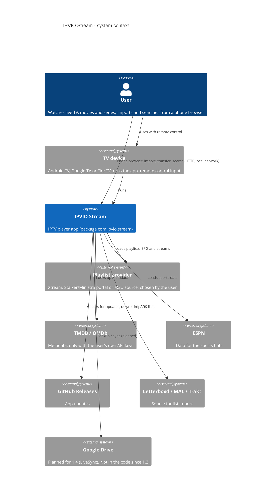
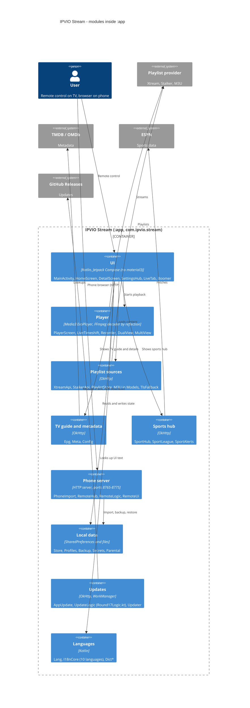

# Diagrams

C4 diagrams in Mermaid. Elements come from the refactoring audit of 2026-11-11 (commit `b65e838`, tag `V1.3`). Relations are indicative. TODO: verify call directions in the code. See [ARCHITECTURE.md](ARCHITECTURE.md).

## Level 1: System context

## Level 2: Containers / modules

The app is one Gradle module (`:app`) with a flat package. The blocks below are logical groupings, not packages or deployable containers.

